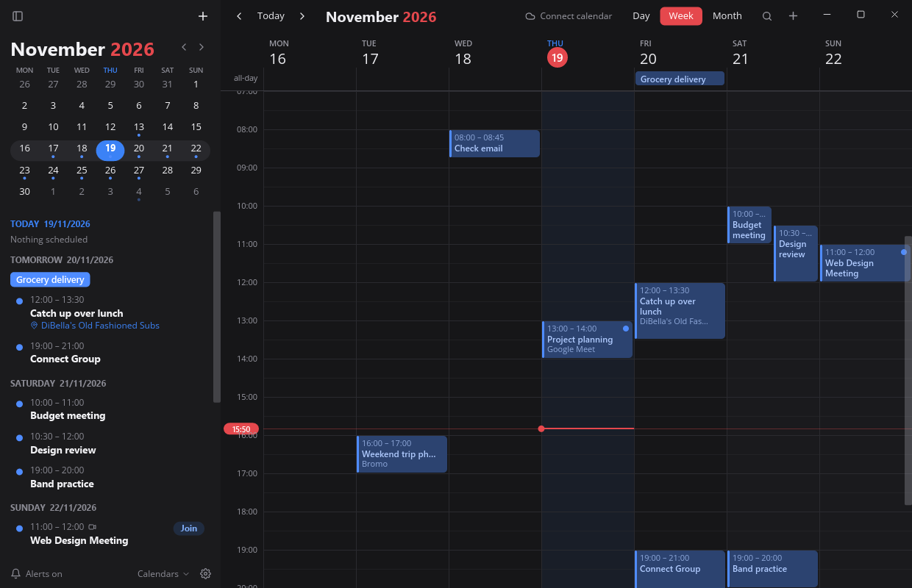
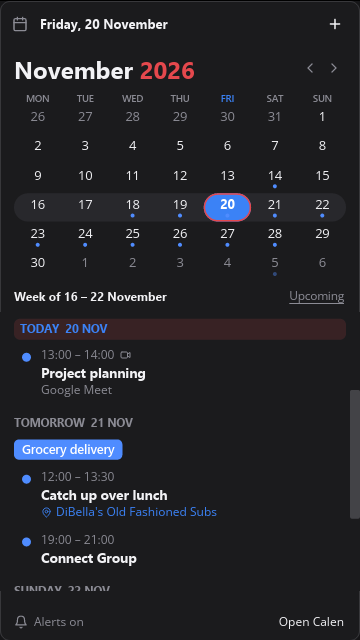
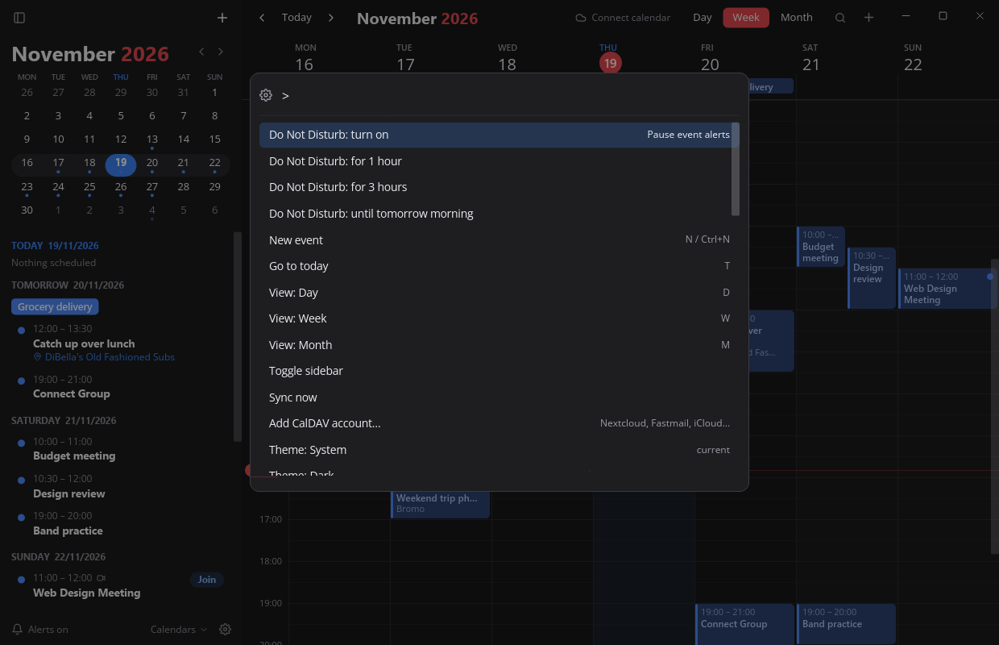
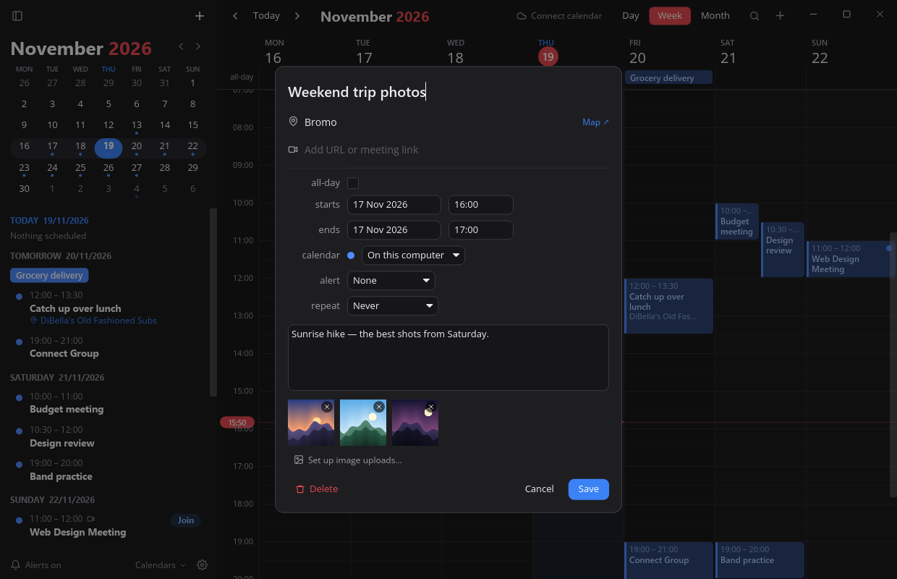

# Calen

A fast, native calendar for Windows and Linux (macOS planned), written in Rust with
[iced](https://iced.rs). No web view. It lives in the system tray, syncs with CalDAV
(tested against Nextcloud and Radicale), and works offline.



| Tray flyout | Command palette | Event photos |
|:---:|:---:|:---:|
|  |  |  |
| This week at a glance from the tray | `Ctrl+P` for events, commands and settings | Images attached to an event |

## Features

- **Tray app.** Starts at login (`--minimized`), and close/minimize hides it to the tray
  (each can be switched off: `> Close to tray`, `> Minimize to tray`). On GNOME the tray
  icon needs the AppIndicator extension (`gnome-shell-extension-appindicator`); without it,
  close/minimize keep Calen running, a *Calen is running* notification (Open / Quit) stays
  in the notification list, and launching Calen again brings the window back. The Flatpak
  shows up under Quick Settings → *Background Apps* instead of that notification, with a
  status line such as *Reminders are on*. On Linux,
  the AppImage adds itself to the app menu (`~/.local/share/applications`) so it gets
  its icon.
  Left-click the tray icon for a flyout with a mini-month and this week's events, opened
  with today at the top (scroll up for earlier days; double-click the icon to open the main
  window on Windows). Click a day to list its week with that day at the top, *Upcoming* or
  the date for the next two weeks, and anywhere outside to close it. Right-click
  opens a menu (Open, New Event, Do Not Disturb, Sync Now, Quit). The tray icon shows
  today's date. Only one copy runs at a time; launching it again brings the window back.
- **Own title bar.** No system title bar: minimize / maximize / close sit in the toolbar,
  and dragging (or double-clicking) the toolbar moves (or maximizes) the window.
- **This week in the sidebar.** The main window's sidebar lists the week of the chosen
  day. Click a date (in the week header, the mini-month or the month grid) to pick it: it
  turns red and moves to the top of the list, while today stays blue.
- **Day / Week / Month views.** Drag events to move them, drag the bottom edge to change
  the length, drag on empty space to create an event, and double-click to open one.
  Multi-day and all-day bars can be dragged across days. For a repeating event you choose
  "this event / all events". Ctrl+Z undoes.
- **Keyboard-first quick add.** Press `N` and type something like
  `Lunch with Sam tomorrow 12:30-13:30 at Café Luna /work !15m`. A live preview shows
  the date, time, place, calendar and alert. Enter adds it; Tab opens the full editor.
- **Command palette.** `Ctrl+P`, `Ctrl+F` or `/` does a fuzzy search over all events.
  Start with `>` for commands and settings (theme, Do Not Disturb, start at login,
  default alert, accounts, image storage, updates, and more).
- **Notifications** with Join / Snooze actions. They are held back while Calen's
  Do Not Disturb is on, during Windows full-screen games, presentation mode or quiet
  hours, and when GNOME/KDE Do Not Disturb or Feral GameMode is active. Windows Focus
  Assist suppresses the toasts itself. Missed alerts are summarized when you return.
  If the system won't show notifications at all (Windows notifications switched off, no
  notification server), Calen shows its own reminder popup in the screen corner instead.
  `> Notifications: send a test alert` checks the whole path. Logs go to `calen.log` in
  the data folder.
- **CalDAV sync** that works offline first: every edit is saved locally and queued, then
  pushed with ETags and pulled incrementally using `sync-collection`. If the same event
  was changed elsewhere, your version is kept as a copy. The toolbar pill shows syncing,
  synced, offline with pending changes, or an error.
- **Meeting links.** Zoom, Google Meet and Teams links get a **Join** button.
- **Map links.** A Google Maps link becomes a clickable place name. Calen saves it as
  standard `LOCATION` + `GEO` + `X-APPLE-STRUCTURED-LOCATION`, so iOS/macOS Calendar
  shows the map too.
- **Images per event (optional).** Uploads are off until you pick a host:
  img.felixadr.com, ImgBB, or your own S3-compatible bucket (AWS S3, Cloudflare R2,
  MinIO, Backblaze B2, Wasabi…). Drop image files onto an event (or use *Add image*);
  the links are stored in the notes as a plain-link block, plus standard
  `ATTACH` properties, so every other client still sees clickable links:
  ```
  📷 Images (calen)
  https://…/photo.jpg
  ```
  Calen shows them as thumbnails. Click one to open a viewer: scroll to zoom, drag to
  pan, ←/→ to move between images.
- **Auto-update** from GitHub Releases. Calen downloads and verifies the update in the
  background, then shows a small floating notice (*Calen X is ready · Restart to update*,
  dismissible) and applies it on the next start. The Flatpak is updated by Flatpak
  instead.

## Install on Linux

- **Flatpak** (recommended; runs on any distro): download `Calen-x86_64.flatpak` from the
  latest release and run `flatpak install --user Calen-x86_64.flatpak`. Flathub is coming.
  The Flatpak keeps its data in `~/.var/app/com.felixadr.Calen`, so if you used the
  AppImage before, it starts with an empty cache and syncs again (saved passwords stay in
  the keyring). Start at login asks the desktop's Background portal for permission.
- **AppImage**: `Calen-x86_64.AppImage` runs on glibc 2.35+ (Ubuntu 22.04, Debian 12) and
  updates itself.

## Memory

Calen draws with the CPU renderer by default, which keeps it small: about 13 MB
private memory with the window open, and about 8 MB (2–3 MB working set) idle in the
tray, where its windows are destroyed instead of hidden. The GPU renderer
(`> Rendering: GPU`) can be smoother on very large windows but costs about 250 MB
while open (GPU driver allocations). `scripts/mem.ps1` measures both.

## Keyboard

| Keys | Action |
|---|---|
| `N` / `Ctrl+N` | Quick add (Tab → full editor) |
| `Ctrl+P` / `Ctrl+F` / `/` | Search events · `>` for commands |
| `Ctrl+,` | Settings (palette with `>`) |
| `T` · `D` `W` `M` · `←` `→` | Today · views · previous/next |
| `J` `K` / `↓` `↑` | Select next/previous event |
| `Enter` · `Delete` · `Ctrl+Z` | Open · delete · undo |
| `Ctrl+S` / `Ctrl+Enter` | Save in the editor |
| `Esc` | Close the overlay / deselect |

## Building

```bash
cargo run -p calen            # debug build
cargo run -p calen -- --seed  # with sample events (empty database only)
cargo test --workspace
```

To try it without touching your real data, set `CALEN_DATA_DIR` to a scratch folder.

The screenshots above come from a scratch folder with `--seed` (no real accounts). In debug
builds, or with `CALEN_DEV=1`, `--flyout` opens the tray flyout and `--demo palette|editor`
opens the palette or an event with photos (`--demo pick:+3`, `month-pick:-5` or
`flyout-pick:+6` picks a date); `scripts/shot.ps1` saves a Calen window to PNG.

**Debian/Ubuntu build dependencies:**

```bash
sudo apt install build-essential pkg-config libdbus-1-dev libxkbcommon-dev libwayland-dev libx11-dev libxcursor-dev libxi-dev libxrandr-dev libvulkan-dev
```

On GNOME, the tray needs the AppIndicator extension (`gnome-shell-extension-appindicator`
on Debian). KDE supports it natively.

**Flatpak build.** Install `org.flatpak.Builder` from Flathub, then:

```bash
flatpak run org.flatpak.Builder --user --install --force-clean build-dir packaging/flatpak/com.felixadr.Calen.yml
flatpak run com.felixadr.Calen
```

The build is offline, so after changing `Cargo.lock`, regenerate
`packaging/flatpak/cargo-sources.json` with
[flatpak-cargo-generator](https://github.com/flatpak/flatpak-builder-tools/tree/master/cargo)
(`flatpak-cargo-generator.py Cargo.lock -o packaging/flatpak/cargo-sources.json`). CI
fails if it's out of date. `packaging/flatpak/flathub/` holds the copy submitted to
Flathub, which builds from a release tag.

**Image uploads** (optional): `Ctrl+P` → `> Image storage: set up uploads…`.

| Host | You need |
|---|---|
| img.felixadr.com | API key (`imk_…`) |
| ImgBB | API key from api.imgbb.com |
| S3-compatible | Endpoint, bucket, region, access key ID + secret. Optional key prefix, a public URL (CDN / custom domain / R2 `pub-….r2.dev`), path-style URLs (MinIO) and a public-read ACL |

**Test upload** in the dialog checks that the bucket accepts uploads *and* that the
resulting link is publicly readable, since other calendar apps open the links without
credentials. Keys and secrets are stored in the OS keyring, never in the settings file
or the binary. Debug builds also read `IMG_API_KEY` from `.env` for img.felixadr.com.

**CalDAV.** Click *Connect calendar* in the toolbar. For Nextcloud, use an app password
(Settings → Security → Devices & sessions). Passwords are stored in the OS keyring.

To run the end-to-end sync test against a server:

```bash
CALEN_TEST_DAV="http://127.0.0.1:5232/,user,pass" cargo test -p calen-sync --test live_server
CALEN_TEST_S3="http://127.0.0.1:9000,bucket,key,secret" cargo test -p calen-images --test live_s3
```

## Releases and updates

Push a tag `vX.Y.Z`. `.github/workflows/release.yml` builds
`calen-windows-x86_64.exe`, `Calen-x86_64.AppImage` (on Ubuntu 22.04, so it runs on
Debian stable) and `Calen-x86_64.flatpak`, adds `.sha256` files, optionally signs them
with minisign, and publishes the GitHub release. Builds made by CI include the repository name, so the app knows
where to look for updates. To enable signature checking, see the comments at the top of
the workflow.

Self-update works for the Windows `.exe` and the AppImage. Local debug builds never
update themselves.

## Layout

```
crates/calen-core    ICS parse/write (lossless), events, recurrence, quick-add parser, link detection, image notes block
crates/calen-store   SQLite cache + pending-ops queue + settings
crates/calen-sync    CalDAV client and sync engine
crates/calen-images  image hosts (img.felixadr.com, ImgBB, S3 SigV4), thumbnails
app/                 iced UI, tray/notifications/DND per OS (app/src/platform), updater
```
